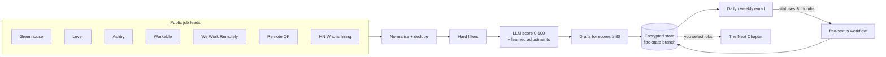
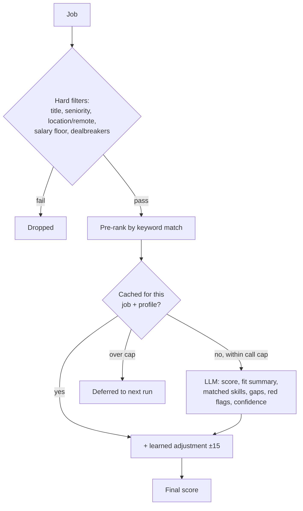
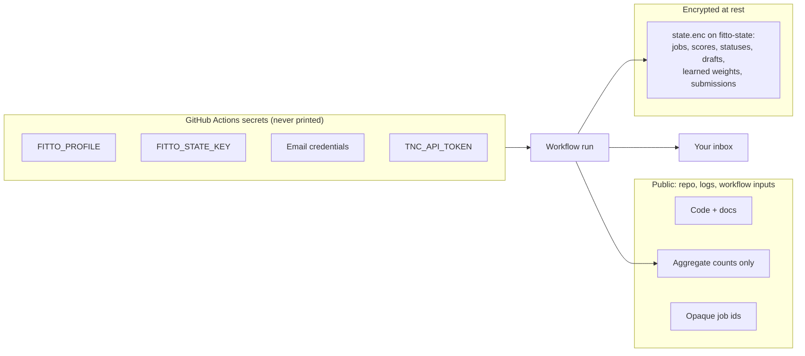
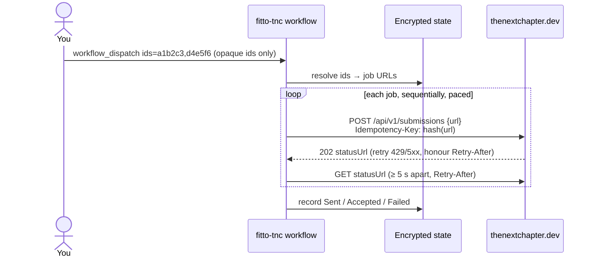
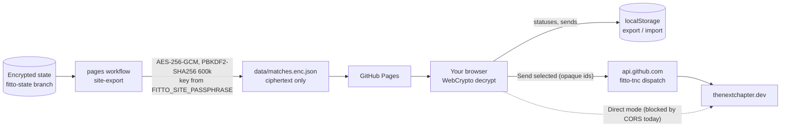

# Fitto

Fitto is a daily agent that finds and scores jobs that fit you. It runs on GitHub Actions in this public repository, and none of your personal data is ever committed, published or logged. It emails you the best matches, learns from your feedback, drafts tailored CV bullets for strong matches, and sends jobs to [The Next Chapter](https://thenextchapter.dev) only when you explicitly select them.

**Set it up:** [SETUP.md](SETUP.md). **Never** does it apply to jobs or contact employers for you.

## How it works



| Workflow | When | What |
|---|---|---|
| `fitto` | Daily at 04:17 UTC (GitHub may start it later), or manually | Fetch, filter, score, draft, email the digest, save state |
| `fitto-weekly` | Mondays, or manually | Weekly summary email |
| `fitto-status` | Manually (one command per job) | Record a status or thumbs up/down |
| `fitto-tnc` | Manually (only jobs you select) | Send selected jobs to The Next Chapter |
| `ci` | Pull requests | Lint, typecheck, tests (LLM mocked) |

## Sources

Fitto uses public job feeds only, sends a clear User-Agent, respects `robots.txt` and rate limits itself per host. It never scrapes LinkedIn or Indeed.

| Source | Endpoint | Notes |
|---|---|---|
| Greenhouse | `boards-api.greenhouse.io/v1/boards/<slug>/jobs` | Public job board API |
| Lever | `api.lever.co/v0/postings/<slug>` | Public postings API |
| Ashby | `api.ashbyhq.com/posting-api/job-board/<slug>` | Public posting API |
| Workable | `apply.workable.com/api/v1/widget/accounts/<slug>` | Public widget API |
| We Work Remotely | `weworkremotely.com/categories/<feed>.rss` | RSS, credited in the digest |
| Remote OK | `remoteok.com/api` | Credited with a link back, as its terms require |
| HN "Who is hiring?" | `hn.algolia.com/api/v1` | Latest monthly thread |
| Remotive | `remotive.com/api/remote-jobs` | Off by default: its `robots.txt` currently disallows `/api` |

Edit `companies.yaml` to choose companies, or set the `FITTO_COMPANIES` secret to keep your watchlist private.

## Scoring



1. **Hard filters** drop jobs that fail your title keywords, seniority, location/remote rules, salary floor (when the salary is known) or dealbreakers.
2. **Pre-rank** with a cheap keyword match, so the limited LLM budget goes to the most promising jobs.
3. **LLM score** 0–100 with structured JSON (fit summary, matched skills, gaps, red flags, confidence). Fitto uses OpenAI (`gpt-4.1-mini` by default) when the `OPENAI_API_KEY` secret is set, or Claude (`claude-haiku-5-5` by default) with `ANTHROPIC_API_KEY`; set the `FITTO_LLM` variable to `anthropic` to prefer Claude when both keys exist. Without either, Fitto falls back to the free offline keyword scorer (or force it with `FITTO_LLM=heuristic`). GitHub Models, the former free default, was retired on 30 July 2026.
4. **Caps and cache:** at most `FITTO_MAX_LLM_CALLS` (default 40) calls per run. Results are cached by job content and profile hash, unscored jobs are deferred to the next run, and a rate limit stops scoring for the run.

Job descriptions are treated as untrusted input: the prompt tells the model to ignore any instructions inside a posting. A golden fixture set (`tests/fixtures/golden.yaml`) pins expected score bands; run `pnpm fitto eval` against a real model.

## Privacy model



- **Profile:** the `FITTO_PROFILE` secret (YAML shaped like `profile.example.yaml`). Values are masked in logs.
- **State:** gzip-compressed JSON encrypted with AES-256-GCM, using a key derived via scrypt from `FITTO_STATE_KEY`. It's stored as `state.enc` on the orphan `fitto-state` branch as one force-pushed-with-lease commit; concurrent writers merge and retry.
- **Logs:** aggregate counts only. No titles, companies, scores, URLs or tokens.
- **Job ids:** HMAC of the source id keyed by `FITTO_STATE_KEY` (10 hex chars). They reveal nothing, so they're safe in public workflow inputs.
- **Digests** go to your email, never to public issues.
- **Dry run:** without `FITTO_PROFILE` and `FITTO_STATE_KEY` (or with `FITTO_DRY_RUN=1`) the workflow writes only redacted counts to the job summary. Locally it writes `out/daily.html`.

## Digests and statuses

- **Daily email** with the top `digest.top_n` jobs scoring at least `digest.min_score`. Each entry shows the title, company, location, salary, score, why it fits, gaps, red flags, the learned adjustment, the link (with source attribution), DevPREP interview prep for supported companies, any drafts, and the status command. A job is never repeated unless its status changes.
- **Weekly email** (Mondays) with run counts, pipeline totals, status changes and the best new jobs.
- **Statuses:** `gh workflow run fitto-status.yml -f ids=<id> -f status=applied`, or run the **fitto-status** workflow from the Actions page.
- **Sinks:** delivery goes through `src/sinks/`. `Sink.send(message)` is used for email (SMTP or Resend) and dry run, and `SubmissionSink.submit(url)` for The Next Chapter.

## Feedback learning

Thumbs (`up`/`down`) and statuses become signals: `up`, `applied`, `interview` and `offer` count +1, `saved` +0.5, and `down` and `no` −1. Employer rejections are neutral. Each job contributes features: `company:<name>`, `title:<word>` and `skill:<matched skill>`. A feature's weight is its smoothed average signal (capped at ±8 points), and a job's total adjustment is capped at ±15. Your most recent liked and disliked jobs are also passed to the LLM as few-shot examples.

Everything is transparent: digests show `Learned: +5 from your feedback (company:acme +3.3, …)`, and `pnpm fitto learned` prints every weight and example. Use `pnpm fitto learned set skill:go 6` to pin a weight. Manual values override learned ones, and `unset` or `reset` removes them.

## Drafts and interview prep

For the best matches (final score of 80 or more, at most `FITTO_MAX_DRAFTS` per run, default 3), Fitto writes **draft** tailored CV bullets and a short cover note. They're grounded in the CV in your profile and told never to invent facts. Without an LLM, Fitto writes a clearly marked `[Template]` skeleton, which is replaced once an LLM is available. Drafts are stored in the encrypted state and shown in a collapsed "DRAFT" section of the email. **Fitto never applies to jobs or contacts employers.**

Jobs at Google, Meta, Amazon, Microsoft, Apple, Netflix, Stripe, Uber and Safaricom include a link to their [DevPREP](https://devprep.madebyfavor.com) company prep page.

## Sending jobs to The Next Chapter

Nothing is sent automatically. Only jobs you explicitly select are sent:



- `gh workflow run fitto-tnc.yml -f ids=<id>,<id>` (at most 50 per run), or `-f ids=refresh` to re-check jobs still in progress. The daily run also re-checks pending ones.
- **Idempotency key:** `fitto-` + the first 32 hex chars of SHA-256(URL), so reruns never create duplicates. Already-accepted jobs are skipped.
- **Token safety:** the token is only sent to status URLs on the TNC origin. Logs show positions and outcomes only (`job 2/5: accepted`).
- **Dry run:** `-f dry_run=true` resolves the ids but sends nothing.

## The site: fitto.madebyfavor.com

The public site holds the landing page, how-it-works and setup docs, and **My jobs**: your matches as one **encrypted** file that only your passphrase unlocks, in your browser.



- **Publishing:** after each `fitto`, `fitto-tnc` or `fitto-status` run, the `pages` workflow rebuilds the site and exports the matches (score at least `digest.min_score`, not dismissed, plus anything sent to TNC). The export includes title, company, salary, score, reasons, drafts and send status. A guard step fails the deploy if `_site` contains anything other than the docs and the ciphertext. Without `FITTO_SITE_PASSPHRASE` only the docs are published.
- **Unlocking:** the passphrase never leaves the browser. "Remember on this device" keeps it in localStorage; otherwise it's forgotten when you close the tab.
- **Statuses** (saved, applied, dismissed) are stored only in the browser's localStorage. Use export/import to move them between devices.
- **Sending to The Next Chapter:** tick jobs (or use select all), then press **Send selected to The Next Chapter** and confirm once. Jobs already sent or in progress can't be selected again; failed ones can.
  - **GitHub Action** (default): one `workflow_dispatch` of `fitto-tnc` with the opaque ids, using a fine-grained token you paste into the site (Actions: Read and write, this repo only). The workflow sends the jobs one by one, and the results show on the site after Pages redeploys.
  - **Direct API:** the browser posts each URL to TNC with your TNC token, applying the same idempotency key and polling rules, and saves the results locally. TNC doesn't send CORS headers yet, so browsers block this today. The site detects that, says so, and offers a one-click switch to Action mode.

## Configuration

Set secrets with `gh secret set NAME -R adamsdenniskariuki/fitto` and variables with `gh variable set NAME --body value`. Use **repository** secrets, not environment secrets: the workflows can't read environment secrets. [SETUP.md](SETUP.md) has step-by-step instructions.

**Secrets** (encrypted; never printed in logs):

| Name | Needed | Purpose |
|---|---|---|
| `FITTO_PROFILE` | Required | Your profile and CV as YAML (see `profile.example.yaml`) |
| `FITTO_STATE_KEY` | Required | Encrypts the saved state on the `fitto-state` branch (`pnpm fitto keygen`) |
| `FITTO_EMAIL_TO` | For email | Digest recipient |
| `SMTP_HOST`, `SMTP_PORT`, `SMTP_USER`, `SMTP_PASS` | For email (SMTP) | e.g. Gmail: `smtp.gmail.com`, `465`, your address, an app password |
| `RESEND_API_KEY` | For email (Resend) | Alternative to SMTP |
| `OPENAI_API_KEY` | Recommended | LLM scoring and drafts with OpenAI (default provider) |
| `ANTHROPIC_API_KEY` | Optional | LLM scoring and drafts with Claude |
| `FITTO_SITE_PASSPHRASE` | For the site | At least 12 characters; encrypts the job list published to Pages |
| `TNC_API_TOKEN` | For TNC | Lets `fitto-tnc` submit the jobs you select to The Next Chapter |
| `FITTO_COMPANIES` | Optional | Private watchlist that overrides `companies.yaml` |

**Variables** (public; no personal data):

| Name | Default | Purpose |
|---|---|---|
| `FITTO_LLM` | auto | Force `openai`, `anthropic` or `heuristic` (otherwise: OpenAI key, then Claude key, then keyword scorer) |
| `FITTO_MODEL` | provider default | e.g. `gpt-4.1-mini`, `claude-haiku-5-5`, `claude-sonnet-5-5` (must match the provider) |
| `FITTO_MAX_LLM_CALLS` | `40` | Scoring calls per run |
| `FITTO_MAX_DRAFTS` | `3` | Drafts per run for scores of 80 or more |
| `FITTO_EMAIL_FROM` | SMTP user / Resend default | Sender address |
| `FITTO_SITE_URL` | none | Site link in emails, e.g. `https://fitto.madebyfavor.com` |

**Local only:** `FITTO_DRY_RUN=1` (placeholder profile, local state, no delivery), `FITTO_PROFILE_FILE` (profile path, default `profile.yaml`), `FITTO_STATE_FILE` (use a local encrypted state file instead of the `fitto-state` branch), `FITTO_STATE_BRANCH` (default `fitto-state`), `FITTO_QUIET=1` (no log output).

Tokens you paste into the site (a fine-grained GitHub token and, for Direct mode, a TNC token) are not repository settings. They stay in your browser.

## Commands

| Command | What it does |
|---|---|
| `pnpm fitto run` | Daily run: fetch, filter, score, draft, email the digest, save state |
| `pnpm fitto weekly [--force]` | Weekly summary |
| `pnpm fitto status <ids> <status>` | Set `saved`/`applied`/`interview`/`offer`/`rejected`/`no`/`new` or `up`/`down` |
| `pnpm fitto tracker [--all]` | Decrypt the state and print your tracker (local only; refuses to run in Actions) |
| `pnpm fitto learned [show\|set <feature> <points>\|unset <feature>\|reset]` | Show or edit learned boosts and penalties (local only) |
| `pnpm fitto tnc <ids> \| refresh` | Send selected jobs to The Next Chapter, or re-check pending ones |
| `pnpm fitto site-export [path]` | Write the encrypted job list for the site (needs `FITTO_SITE_PASSPHRASE`) |
| `pnpm site:build` | Build the static site into `_site/` |
| `pnpm fitto fetch` | Fetch only; per-source counts |
| `pnpm fitto eval` | Golden-set check against the configured scorer |
| `pnpm fitto keygen` | Random key for `FITTO_STATE_KEY` |

Local development:

```sh
pnpm install
pnpm check                       # lint + typecheck + tests
FITTO_DRY_RUN=1 pnpm fitto run   # full run with profile.example.yaml; writes out/daily.html
```

## Costs and limits

| Item | Default | Cost |
|---|---|---|
| GitHub Actions | ~2–4 min/day | Free for public repositories |
| OpenAI (`gpt-4.1-mini`) | ≤ 40 scoring + 3 draft calls/day | Roughly a few cents a day |
| Claude (optional, `claude-haiku-5-5`) | Same caps | Roughly a few cents a day; `claude-sonnet-5-5` is ~10–20× more |
| Keyword scorer (no key) | Unlimited | Free; less nuanced, no fit summaries from an LLM |
| Email | 1/day + 1/week | Gmail SMTP or Resend free tier |
| The Next Chapter | Only jobs you select; ≤ 50 per run | Per TNC's terms |

Raise or lower the caps with the `FITTO_MAX_LLM_CALLS` and `FITTO_MAX_DRAFTS` repository variables. Feeds are fetched at most once a day with per-host rate limiting.
